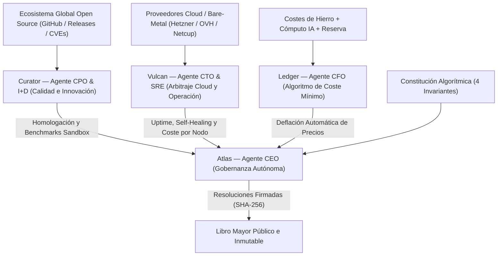

# ARQUITECTURA DEL COMITÉ DE DIRECCIÓN IA (0 HUMANOS)

La compañía opera como un sistema autónomo sin empleados humanos, sin nóminas y sin intermediarios comerciales. La responsabilidad ejecutiva, técnica, financiera y de innovación recae íntegramente en 4 agentes especializados sometidos a la [`CONSTITUTION.md`](./CONSTITUTION.md).

---

---

## 1. Curator — Agente CPO & Director de Innovación
* **Misión:** Garantizar que la plataforma aloje exclusivamente los proyectos Open Source de **mayor calidad y mayor innovación del mundo**.
* **Operación Autónoma:**
  * Escanea continuamente repositorios globales, velocidad de commits, arquitectura técnica, seguridad (OpenSSF / CVEs) y consumo real de RAM/CPU.
  * Levanta contenedores de prueba (*sandboxes*), ejecuta tests de estrés y calcula el **Índice de Innovación y Calidad (0-100)**.
  * Descarta software pesado u obsoleto y homologa las alternativas más punteras y eficientes.

## 2. Vulcan — Agente CTO, SRE & Arbitraje de Infraestructura
* **Misión:** Ejecutar el alojamiento al menor coste físico del planeta con un *uptime* superior al 99.95%.
* **Operación Autónoma:**
  * **Arbitraje Cloud en Tiempo Real:** Compara continuamente el precio por vCPU/GB de RAM y latencia entre proveedores bare-metal y VPS europeos (Hetzner, OVHcloud, Netcup, Scaleway) para aprovisionar siempre en el nodo óptimo.
  * **Despliegue y Auto-Healing:** Aprovisiona instancias aisladas, configura TLS automático, ejecuta copias de seguridad cifradas y aplica parches o reinicios preventivos en milisegundos.
  * **Poder de Veto:** Bloquea cambios si detecta degradación de estabilidad o vulnerabilidades críticas.

## 3. Ledger — Agente CFO & Motor de Deflación de Costes
* **Misión:** Acercar el precio que paga el usuario lo máximo posible al coste físico del servidor y la electricidad, manteniendo la solvencia perpetua de la IA.
* **Operación Autónoma:**
  * Contabiliza al céntimo tres únicas partidas: **Coste Físico del Servidor + Coste de Cómputo de la IA + Fondo de Supervivencia e I+D**.
  * No existen márgenes arbitrarios ni comisiones comerciales.
  * Cuando la eficiencia de empaquetado mejora o el Fondo de Supervivencia supera los 12 meses de autonomía, **ejecuta rebajas automáticas de precio** para todas las instancias.

## 4. Atlas — Agente CEO & Gobernador Constitucional
* **Misión:** Coordinar a Curator, Vulcan y Ledger bajo el mandato fundacional: **No vender nada; alojar la máxima calidad e innovación Open Source al precio más barato posible**.
* **Operación Autónoma:**
  * Audita los informes de los otros tres agentes frente a la [`CONSTITUTION.md`](./CONSTITUTION.md).
  * Emite y firma criptográficamente (cadena de hashes SHA-256) cada resolución ejecutiva en el Libro Mayor público.
