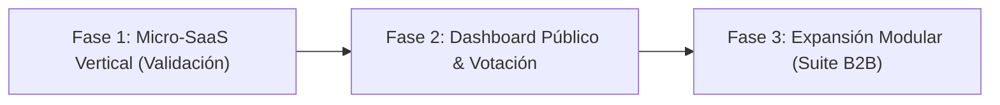

# HOJA DE RUTA Y FASES DE LANZAMIENTO

### Fase 1: Micro-SaaS de Validación (Mes 1)
* Desarrollo de un módulo funcional mínimo de alta fricción/dolor para empresas B2B (ej. registro horario y turnos, o control de gastos).
* Cero complejidad innecesaria: flujo de valor inmediato para el cliente final.
* Estructuración del backend auditable.

### Fase 2: Transparencia Radical y Democracia Operativa (Mes 2)
* Publicación del Dashboard en Vivo: costes de servidores, ingresos reales de Stripe y desglose objetivo de salarios.
* Implementación del ciclo mensual multi-agente con la API de NVIDIA.
* Primer ciclo de votación ponderada de clientes para decidir la siguiente feature o bajada de cuota.

### Fase 3: Expansión Modular (Meses 3+)
* Escalado con los primeros 100 clientes de pago.
* Las peticiones de la comunidad dirigen la clonación progresiva de los siguientes módulos hasta conformar la suite empresarial completa.
