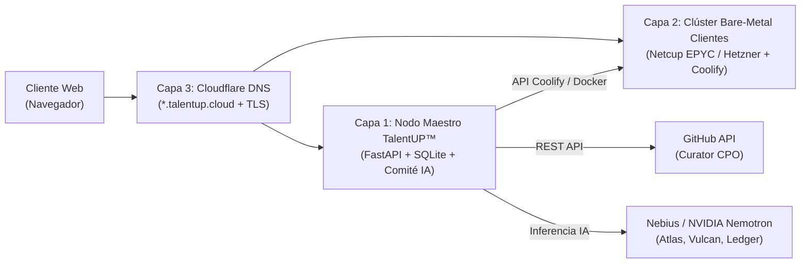

# 🚀 GUÍA DE PRODUCCIÓN, HOSTING Y GESTIÓN AUTÓNOMA — TalentUP™

Esta guía explica paso a paso **dónde alojar `TalentUP™`**, **cómo conectar el aprovisionamiento real de contenedores para clientes** y **cómo gestionar el negocio con 0 empleados humanos**.

---

## 1. Arquitectura Física de Producción (Las 3 Capas)

Para que **`TalentUP™`** funcione como la primera empresa 100% autónoma que aloja el mejor software Open Source a coste físico, la infraestructura se divide en **3 capas limpias y baratas**:



### Capa 1: Dónde alojar la Web Principal y el Comité IA (Este Repositorio)
* **Qué contiene:** El frontend `index.html`, la API FastAPI (`02_ENGINEERING/backend/main.py`), el motor constitucional (`03_AGENTS/`) y la base de datos SQLite con la cadena de bloques SHA-256.
* **Dónde alojarlo (3 opciones):**
  1. **Opción Recomendada (VPS Dedicado con Docker + HTTPS automático — ~4,50€/mes):**
     * Contrata un **Hetzner Cloud CX22** (Nuremberg/Falkenstein) o **Netcup VPS 500 G11**.
     * Clona esta carpeta en el servidor y ejecuta un único comando:
       ```bash
       docker compose -f docker-compose.prod.yml up -d --build
       ```
     * El contenedor `caddy-tls-proxy` incluido en [`docker-compose.prod.yml`](../docker-compose.prod.yml) obtiene y renueva automáticamente los certificados HTTPS de Let's Encrypt para `talentup.cloud`.
  2. **Opción PaaS 1-Clic (Railway / Render / Fly.io):**
     * Sube este repositorio a tu cuenta de GitHub y conéctalo a **Railway** o **Render**. Detectará automáticamente el [`Dockerfile`](../Dockerfile) de la raíz y lo publicará con HTTPS en 90 segundos.

### Capa 2: Dónde alojar las Cápsulas Single-Tenant de los Clientes
* **Qué proveedor elegir:**
  * **Opción #1 (Ganador de Arbitraje de Vulcan): Netcup Root-Server RS 8000 G11 (AMD EPYC, 16 vCPU, 64 GB RAM DDR5, 2 TB NVMe en Nuremberg DE-1)** por **~29,90 €/mes**.
  * **Opción #2: Hetzner Dedicated AX42 (AMD Ryzen PRO, 64 GB RAM NVMe en Falkenstein DE-2)** por **~46,00 €/mes**.
* **Cómo se orquestan los contenedores de clientes sin tocar consola:**
  1. En ese servidor de 64 GB RAM instala **Coolify** (PaaS 100% Open Source autoalojado) con su comando oficial de 1 línea:
     ```bash
     curl -fsSL https://cdn.coollabs.io/coolify/install.sh | bash
     ```
  2. Activa la API en el panel de Coolify (`Settings -> API Tokens`) y pega tu token en `04_CONFIG/.env` (`COOLIFY_API_TOKEN=...`).
  3. Cada vez que un cliente despliega **Twenty CRM**, **Plane**, **Mattermost**, **Chatwoot**, **Documenso** u **Odoo CE** desde `TalentUP™`, `Vulcan (CTO IA)` genera el manifiesto `docker-compose.yml` aislado (con su propio PostgreSQL 16 y límite de memoria RAM) y lo despliega en el servidor.
  4. **Capacidad real:** Un solo servidor de 64 GB RAM (29,90 €/mes) aloja holgadamente entre **35 y 45 cápsulas de empresas clientes**.

### Capa 3: Configuración de Dominio y Subdominios Automáticos (`*.talentup.cloud`)
1. Compra tu dominio en **Cloudflare** (ej. `talentup.cloud`).
2. Crea dos registros `A` en el panel DNS de Cloudflare:
   * `A` -> `@` (`talentup.cloud`) apuntando a la IP de tu Capa 1 (Web Principal).
   * `A` -> `*` (`*.talentup.cloud`) apuntando a la IP de tu Capa 2 (Servidor Coolify/Traefik de Clientes).
3. Gracias al registro comodín `*`, cuando un cliente escriba `mi-empresa` en el modal de despliegue, el subdominio `https://mi-empresa.talentup.cloud` existirá al instante con certificado TLS X.509 válido sin intervención humana.

---

## 2. Cómo Gestionar la Economía del Negocio (Invariante 2)

El motor financiero (**Ledger CFO**) aplica automáticamente la fórmula de `03_AGENTS/constitution.py`:

$$\text{Cuota Mensual Exacta} = \text{Coste Físico Bare-Metal} + \text{Cómputo IA} + \text{Reserva de Supervivencia}$$

* **Fase 1 (Construcción del Colchón < 12 meses):** El sistema aplica un **12% de Reserva de Supervivencia e I+D** sobre el coste operativo para acumular en la cuenta de tesorería de la empresa el equivalente a 12 meses de servidores pagados por adelantado.
* **Fase 2 (Deflación Automática >= 12 meses):** En cuanto la reserva supera los 12 meses, la tasa cae automáticamente al **3%** y cualquier mejora de arbitraje de servidores reduce directamente el recibo mensual de todos los clientes activos.
